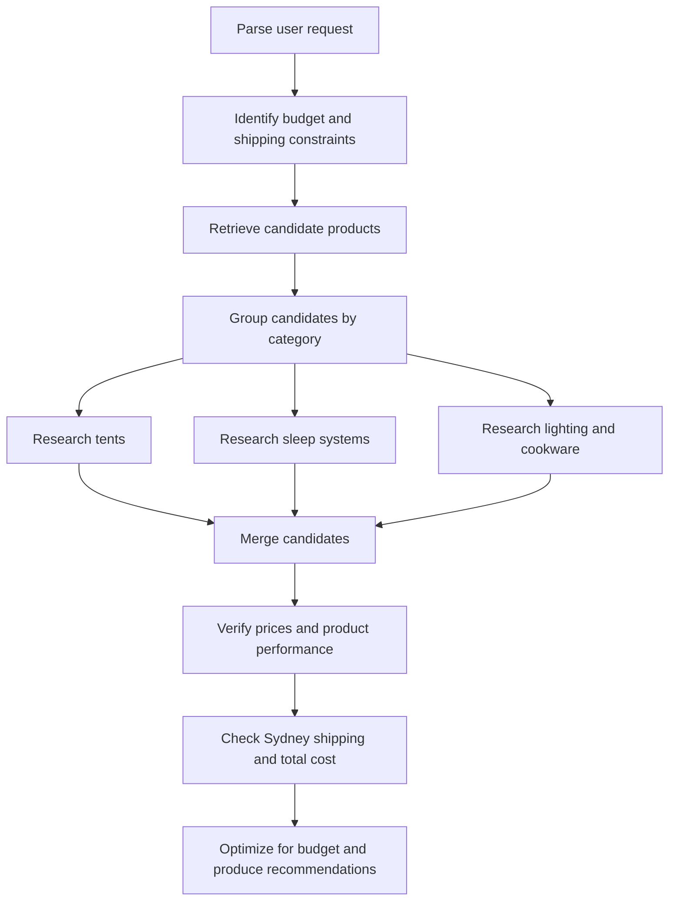
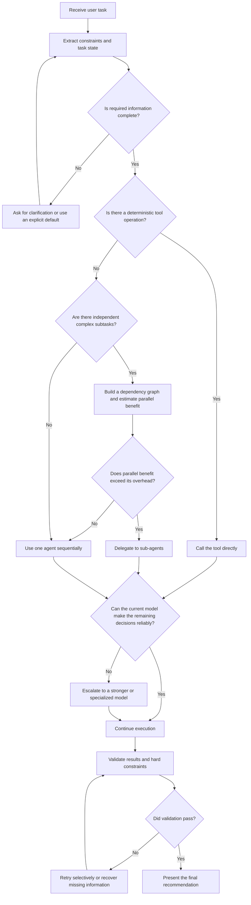
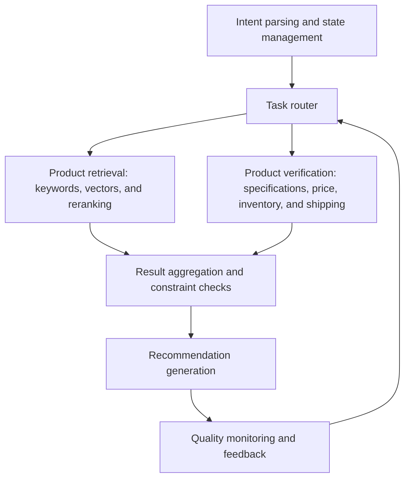

## Summary

Consider a request such as:

> Recommend camping gear in the low-to-mid price range and ship it to Sydney.

This is more than a product search. It is a decision workflow that must interpret the request, retrieve products, evaluate candidates, verify prices and inventory, confirm shipping eligibility, and present useful results.

A reliable cross-border AI shopping assistant needs to address four core questions:

1. How can keyword and vector search work together to find products that match the user's actual intent?
2. When should the system call a tool, delegate to a sub-agent, or run tasks in parallel?
3. How can context be compressed without losing the constraints, evidence, and execution state needed to complete the task?
4. How should the system choose tools, execution strategies, and models based on task complexity, quality requirements, latency, and cost?

This article explores these questions from both a system-design and an implementation perspective.

---

## 1. Keyword Search and Vector Search

### 1.1 Key differences

**Keyword search** retrieves results based on matches between query terms and terms in product content. Common implementations include inverted indexes and BM25. It works well for brands, model numbers, SKUs, explicit specifications, and exact attributes.

**Vector search** encodes a query and product content as vectors using an embedding model, then retrieves candidates based on vector distance or similarity. It is useful for synonyms, conversational descriptions, implicit needs, and related concepts expressed with different wording.

| Retrieval method | Main strengths | Main limitations | Typical use cases |
|---|---|---|---|
| Keyword search | Precise and explainable; effective for explicit terms and structured fields | Limited recall for synonyms and cross-language paraphrases | Brands, model numbers, SKUs, specifications |
| Vector search | Captures semantic similarity and supports natural-language queries | Semantic similarity does not prove a fact; irrelevant candidates may be retrieved | Conversational needs, synonyms, cross-language retrieval |
| Hybrid retrieval | Combines term matching and semantic recall | Requires candidate merging, deduplication, and ranking | General product discovery and recommendations |

### 1.2 Why can “rugged and drop-resistant” match a product that uses different wording?

Suppose a user searches for “rugged and drop-resistant,” but a product page does not use those exact words. Instead, it says:

- “Impact-resistant ABS housing”
- “Passed a 1.5-meter drop test”
- “Reinforced structural design”
- “Durability optimized for outdoor use”

Vector search may retrieve the product because embedding models learn statistical relationships between words, sentences, and contexts during training. Terms such as “drop-resistant,” “impact-resistant,” and “drop-tested” may be close in vector space.

However, three concepts must remain distinct:

1. **Semantic similarity does not mean equivalent attributes.** “Waterproof” and “suitable for rainy weather” may be semantically related, but they do not imply the same protection rating.
2. **Semantic similarity does not establish a fact.** “Military-grade design” does not necessarily mean the product has passed a particular standard or certification test.
3. **Retrieval is not performance verification.** Vector search can discover candidates; it cannot by itself prove that a product is drop-resistant.

In cross-border commerce, users may describe their needs in Chinese while product titles, specifications, and certifications are in English or another language. Multilingual embeddings can help with cross-language retrieval, but key specifications and supporting evidence still need to be verified.

### 1.3 Recommended approach: hybrid retrieval and reranking

Use **hybrid retrieval** rather than choosing between keyword and vector search.

A recommended workflow:

1. **Parse the request:** extract product categories, budget, destination, hard constraints, and soft preferences.
2. **Retrieve candidates in parallel:** use keyword and vector search independently.
3. **Merge and deduplicate:** reconcile product IDs, SKUs, and variants to avoid duplicate candidates.
4. **Rerank for relevance:** use BM25 scores, vector similarity, a Cross-Encoder, or another reranker to assess query-product relevance.
5. **Filter hard constraints:** verify price limits, inventory, and destination shipping eligibility.
6. **Validate evidence:** for attributes such as durability, water resistance, or load capacity, prefer specifications, test reports, or trustworthy product records.
7. **Generate recommendations:** present the rationale, price, evidence for performance claims, shipping information, and relevant caveats.

An important principle is: **validate or filter hard constraints first; use soft preferences mainly for ranking.**

For example, a product that cannot be shipped to Sydney should not make the final recommendation list, even if its semantic similarity score is high.

---

## 2. Sub-Agent Delegation and Parallel Execution

### 2.1 Distinguishing tool calls, sub-agents, and parallel execution

- **Tool calling** performs a specific operation, such as querying a product API, checking inventory, or calculating a total.
- A **sub-agent** receives a relatively self-contained subgoal and works with its own context, tool permissions, or execution strategy.
- **Parallel execution** runs multiple tasks at the same time. It does not require a multi-agent architecture; one agent can issue several tool calls in parallel.

Not every tool call should be wrapped in an agent. Querying the price of one product usually requires only a product API call. Searching for several products does not mean that each product needs its own agent.

### 2.2 When is it worth delegating to a sub-agent?

Evaluate four factors:

1. **Decomposability:** Can the task be split into relatively independent subtasks, such as researching tents, sleep systems, and lighting?
2. **Dependencies:** Can a subtask make progress without waiting for the results of another?
3. **Specialization benefit:** Do different subtasks need different tools, retrieval strategies, prompts, or validation logic?
4. **Cost-benefit:** Do the latency or quality gains from parallel work outweigh startup, coordination, aggregation, and duplicated-reasoning costs?

For a camping-gear recommendation:

| Subtask | Suggested approach | Reason |
|---|---|---|
| Look up the price of one tent | Call a tool directly | The input and operation are well defined |
| Compare the construction and durability of several tents | Consider a product-research agent | Requires synthesizing information across candidates |
| Check inventory for tents and sleeping bags | Call APIs in parallel | Independent tasks with structured results |
| Calculate the total cost of a gear bundle | Calculate directly or use a calculation tool | Deterministic; no separate reasoning agent is needed |
| Verify shipping restrictions for Australia | Use a logistics tool or delegate shipping verification | Depends on data-source complexity and verification needs |
| Merge recommendations and remove duplicates | Keep this with the main agent | Requires global consistency and a final decision |

Delegation should depend on task complexity, dependencies, and execution cost—not on the task's name.

### 2.3 Why are two agents running in parallel not necessarily faster?

Parallelism reduces waiting only for the portion that can run concurrently. It cannot eliminate dependencies or coordination overhead.

Suppose:

- Agent A searches for tents and takes 4 seconds.
- Agent B searches for sleeping bags and takes 5 seconds.
- The main agent takes 2 seconds to aggregate, deduplicate, and verify results.

If the tasks run sequentially:

\[
T_{\text{serial}} = 4 + 5 + 2 = 11\text{ seconds}
\]

If the first two tasks run in parallel:

\[
T_{\text{parallel}} = \max(4,5) + 2 = 7\text{ seconds}
\]

Under ideal conditions, parallel execution reduces the total time from 11 to 7 seconds, or about 36%.

But if parallel work adds 1.5 seconds of startup and coordination overhead plus 1 second to resolve conflicting data, then:

\[
T_{\text{parallel}} = 5 + 1.5 + 2 + 1 = 9.5\text{ seconds}
\]

The benefit is much smaller. These numbers illustrate the calculation; they are not production benchmarks.

Common parallel-execution bottlenecks include:

- **Shared-resource contention:** multiple agents call the same rate-limited API, causing throttling or queues.
- **Dependency blocking:** shipping verification requires an SKU that has not yet been selected.
- **Duplicate work:** agents find the same product and repeat tool calls.
- **Coordination cost:** the main agent must reconcile prices, currencies, shipping terms, and product identifiers.
- **Tail latency:** the final response must wait for the slowest required task.
- **Conflicting results:** agents may disagree, requiring additional verification.

More parallelism does not necessarily mean greater throughput. Shared resources, rate limits, and coordination overhead can offset the gains.

### 2.4 Use a task dependency graph to plan execution

First parse the request, then plan work according to its dependencies. For example:



Researching independent product categories is suitable for parallel execution. Budget optimization and final shipping verification depend on aggregated results, so they should not be performed prematurely.

---

## 3. Context Compression and Preserving Task Information

### 3.1 The goal is to reduce cost, not merely shorten text

Context compression should reduce token usage while preserving task completion, factual accuracy, and constraint adherence as much as possible.

A shopping assistant should preserve:

| Information type | Example | Recommended handling |
|---|---|---|
| Hard constraints | Destination is Sydney, a firm budget cap, item must be in stock | Preserve exactly; do not casually rewrite |
| Soft preferences | Low-to-mid budget, durable, lightweight | Keep their meaning and priority |
| Execution state | SKUs already queried, verification results, unfinished tasks | Preserve results, evidence sources, and validity |
| Dynamic information | Prices, inventory, shipping estimates | Keep timestamps or expiry; re-query when needed |
| Evidence and uncertainty | Seller claims, independent tests, unverified attributes | Distinguish evidence types; never overstate certainty |

If a user gives an exact budget, preserve the amount and currency rather than summarizing it as “limited budget.” If the user only says “low-to-mid budget,” do not silently turn that into an unconfirmed price cap. The system can state a transparent default assumption or ask the user when necessary.

Likewise, compression must not turn “the seller claims impact resistance” into “passed an impact-resistance test,” or remove the currency from an Australian-dollar price.

### 3.2 Evaluate compression quality through task performance

A summary that looks semantically similar to the original conversation may still have dropped information needed for execution. A better evaluation is to give the compressed context to the system and test whether it can complete the original task correctly.

A basic metric is task completion rate:

\[
Q_{\text{compression}} =
\frac{\text{test tasks completed correctly after compression}}
{\text{all test tasks}}
\]

Evaluation should also track hard-constraint violation rate, factual error rate, tool-call accuracy, and final recommendation quality.

Useful test scenarios include:

- After the user specifies a maximum budget, does the system still filter out products that exceed it?
- After the user specifies Sydney as the destination, does the system still verify shipping there?
- When the user requests drop resistance, does the system distinguish seller claims from test evidence?
- After the user rejects a product, does the system avoid recommending it again?
- When a product's price changes, does the system query it again rather than rely on stale information?

Hard-constraint violations should be tracked independently; correct results elsewhere must not cancel them out.

For example:

\[
R_{\text{violation}} =
\frac{\text{tasks violating at least one hard constraint}}
{\text{all tasks}}
\]

If a compression strategy reduces token cost by 40% but noticeably increases shipping errors, it should not be considered successful. The 40% figure is illustrative, not a universal threshold.

### 3.3 Use structured state and on-demand summaries

Avoid compressing all task state into one paragraph of natural language. A more robust approach is to preserve critical state in structured form and summarize repetitive conversation or low-value logs on demand.

For example:

```json
{
  "intent": "camping_gear_recommendation",
  "destination": {
    "city": "Sydney",
    "country": "Australia"
  },
  "budget": {
    "level": "low_to_mid",
    "currency": "AUD",
    "exact_cap": null
  },
  "preferences": [
    "durable",
    "value_for_money"
  ],
  "constraints": {
    "shipping_to_destination_required": true
  },
  "evidence": {
    "product_specs": [],
    "shipping_checks": [],
    "price_checks": []
  },
  "pending_tasks": [
    "retrieve_products",
    "verify_shipping",
    "compare_total_cost"
  ]
}
```

This is an example only; define the actual fields to fit the business requirements.

Structured state helps to:

- Reduce the risk of losing critical constraints in a summary.
- Separate user preferences, product facts, and evidence sources.
- Track task progress and outstanding work.
- Identify results that have expired and need to be queried again.
- Give the main agent and sub-agents a shared state definition.

Prices, inventory, and shipping eligibility are dynamic. Even correctly compressed context can contain outdated query results. Information completeness and data freshness must therefore be managed separately.

### 3.4 Establish layered evaluation

Evaluate a compression strategy at three levels:

1. **Constraint-preservation tests:** compare hard constraints, soft preferences, currency, destination, rejected items, and unfinished tasks before and after compression. Missing a critical field is a failure.
2. **Execution replay:** with the same product snapshot, tool responses, and task conditions, compare tool choices, filtering, and final recommendations before and after compression.
3. **Online quality monitoring:** track budget violations, shipping errors, factual errors, task completion, latency, and token cost; analyze results by task type.

Adaptive compression is also useful: compress repetitive conversation and low-value logs first, preserve hard constraints, key evidence, and execution state, and recover relevant details from the original record when missing information is detected.

---

## 4. Automatic Routing: Tool Calls, Sub-Agents, and Model Selection

### 4.1 Define three types of action

**Action A: Call a tool directly**

Use this when the input is clear, the operation is deterministic, and the output is structured—for example, looking up an SKU price, checking inventory, or calculating a total.

**Action B: Delegate to a sub-agent**

Use this for multi-step research that can run independently or has a clear specialist boundary—for example, comparing the construction, durability, and value of several tents.

**Action C: Switch models**

Use this when the current model cannot meet quality requirements for reasoning, tool planning, multilingual understanding, long-context processing, or structured output. Examples include complex budget optimization, conflicting evidence, and decisions across product bundles.

These actions are not mutually exclusive. A complex task can use a stronger model to plan, delegate independent research to sub-agents, and then call tools to verify prices and inventory.

### 4.2 Choose a strategy based on cost, latency, and risk

A router should consider:

| Feature | Question |
|---|---|
| Task complexity | How many reasoning steps are needed? Are there several viable options? |
| Decomposability | Are there independent subtasks? |
| Tool determinism | Is there a directly applicable API or function? |
| Failure risk | Could an error cause a budget breach, shipping mistake, or false promise? |
| Current model capability | Can the current model complete the task reliably? |
| Latency budget | How quickly does the user need a response? |
| Cost budget | What are the token, tool-call, and agent-startup costs? |
| Information completeness | Are the key constraints and required parameters available? |

Routing can be modeled as a quality-constrained cost optimization problem:

\[
a^* = \arg\min_{a \in A}
\left[
C(a) + \lambda L(a) + \mu R(a)
\right]
\]

where:

- \(a\) is a candidate execution strategy;
- \(C(a)\) is its expected cost;
- \(L(a)\) is its expected latency;
- \(R(a)\) is its expected error risk;
- \(\lambda\) and \(\mu\) are business-defined weights.

The system should also enforce a minimum quality threshold; it must not choose an obviously unreliable strategy just to reduce cost. Weights and thresholds should be calibrated through offline evaluation and online experiments, not fixed by intuition alone.

### 4.3 Example routing flow



The guiding principle is: **perform deterministic, lower-cost operations before spending resources on more expensive reasoning.**

For example, first filter a structured product database for reasonable prices and shipping eligibility; then ask a model to analyze durability, use cases, and bundle value. This division is generally easier to verify and control than relying on a large language model to infer products, prices, and shipping eligibility from scratch.

### 4.4 When should the system switch models?

Model escalation should be triggered by clear failure signals or capability requirements—not simply because a task is long or appears complex.

Possible triggers include:

- Repeated failure to produce output that matches a schema.
- Repeatedly incorrect tool-call parameters.
- Inability to reliably resolve complex constraint conflicts between candidates.
- A requirement for more effective context than the current model can reliably handle.
- Evaluation results showing that the current model performs significantly worse on similar tasks than a stronger model.

Distinguish model limitations from infrastructure failures. If a product API times out, switching to a more capable language model will not usually fix the network or service. Consider retries, another data source, or a defined fallback instead.

Choose models based on evaluated task performance, not solely on a model's own assessment of its abilities.

### 4.5 Improve routing continuously with execution logs

Start with rule-based routing:

- Structured, deterministic tasks: call a tool directly.
- Independent, complex subtasks: evaluate whether agent delegation is worthwhile.
- High uncertainty, complex reasoning, or repeated failures: consider a stronger model.
- Missing critical inputs: ask for clarification or use a documented default.

Then collect execution logs, including task type, routing action, actual latency, token and tool costs, success rate, retries, and hard-constraint violations.

Offline replay, A/B tests, or a calibrated routing model can help learn effective strategies for different task types. Continuously calibrate routing against real outcomes; do not rely only on static rules or a model's self-assessment.

---

## 5. Recommended Production Architecture

Consider dividing the system into these modules:

1. **Intent parsing and state management:** extract budget, destination, preferences, hard constraints, and task state.
2. **Task router:** decide whether to call a tool directly, delegate to sub-agents, or switch models.
3. **Product retrieval:** retrieve candidates with keyword search, vector search, and reranking.
4. **Product verification:** validate specifications, inventory, price, shipping eligibility, and information freshness.
5. **Result aggregation and constraint checks:** reconcile currency, price basis, performance evidence, and shipping terms.
6. **Recommendation generation and quality monitoring:** explain recommendations with evidence and monitor failure modes.



Responsibilities should be clear:

- The retrieval layer discovers candidate products.
- The orchestration layer assigns work and manages dependencies.
- Context management preserves the state needed to complete the task.
- The verification layer prevents unsupported or stale information from reaching the final answer.
- The monitoring layer evaluates quality, latency, and cost, and informs future routing improvements.

---

## 6. Implementation Roadmap and Conclusion

Proceed in stages:

### Stage 1: Establish retrieval and constraint validation

Implement hybrid keyword and vector retrieval, candidate deduplication, relevance reranking, and validation of hard constraints such as price, inventory, and shipping eligibility. Prioritize retrieval quality and factual accuracy.

### Stage 2: Establish structured task state and compression evaluation

Define what information must be preserved, distinguishing user preferences, product facts, evidence sources, and dynamic state. Use test sets and execution replay to evaluate performance after compression.

### Stage 3: Introduce conditional agent parallelism

Split work using a task dependency graph and prioritize parallel execution for independent subtasks. Use measured latency, failure rates, and coordination costs to determine whether parallelism is beneficial.

### Stage 4: Improve automatic routing and model selection

Continuously calibrate tool use, sub-agent delegation, and model escalation based on real task completion, latency, cost, and error risk.

The system should not optimize for the number of agents, model size, or compression ratio. A better goal is to **choose the least costly and fastest verifiable path that still meets quality and safety requirements**.

A reliable cross-border shopping assistant must do more than retrieve semantically relevant products. It should support important claims with evidence, use current price and shipping information, and ensure the entire workflow respects the user's budget and destination constraints.
