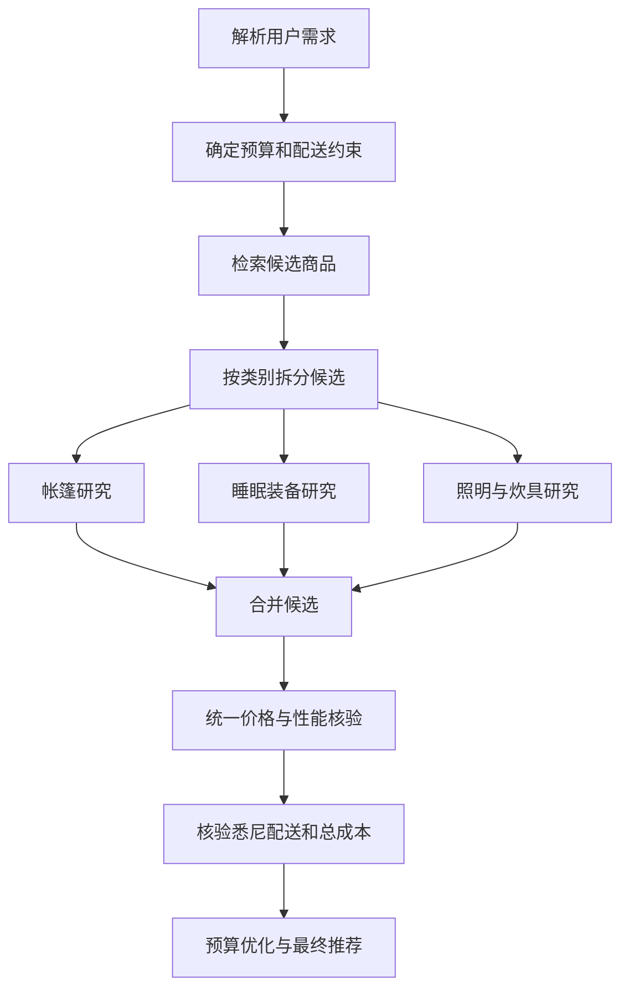
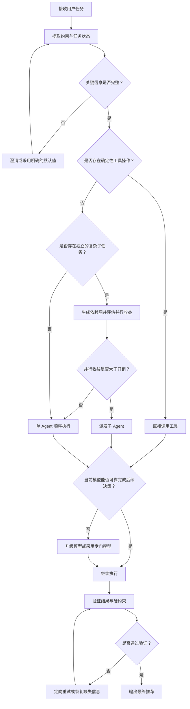
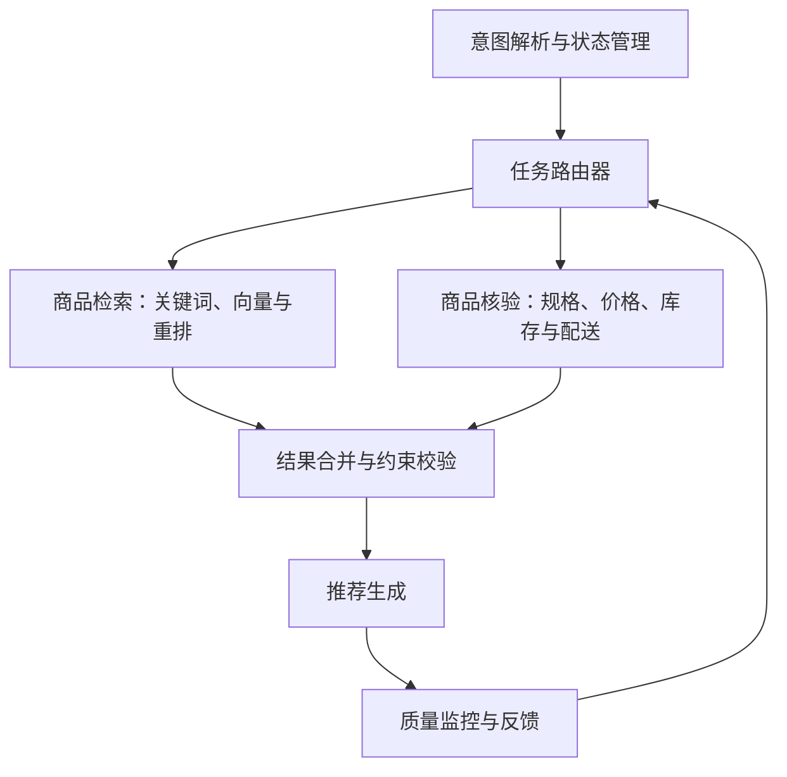

## 摘要

以用户提出的需求为例：

> 推荐露营装备，预算中低，寄到悉尼。

这不是单一的商品搜索任务，而是一个需要协同完成需求理解、商品检索、候选评估、价格与库存核验、配送资格确认及结果生成的决策流程。

要构建可靠的跨境电商 AI 购物助手，需要解决四个核心问题：

1. 如何结合关键词检索与向量检索，找到符合用户真实意图的商品？
2. 什么时候应调用工具，什么时候应派发子 Agent，以及并行执行是否值得？
3. 如何压缩上下文，同时保留完成任务所需的关键约束、证据和执行状态？
4. 如何根据任务复杂度、质量要求、延迟和成本，自动选择执行策略与模型？

本文从系统设计和工程落地的角度逐一说明。

---

## 一、关键词检索与向量检索

### 1.1 核心区别

**关键词检索（Keyword Search）** 根据查询词与商品文本中的词项匹配程度进行检索。常见实现包括倒排索引和 BM25。它适合品牌、型号、SKU、明确规格及精确属性等场景。

**向量检索（Vector Search）** 使用 Embedding 模型将查询与商品文本编码为向量，再依据向量之间的距离或相似度召回候选。它适合处理同义表达、口语描述、隐含需求以及不同措辞表达的相近概念。

| 检索方式 | 主要优势 | 主要局限 | 典型场景 |
|---|---|---|---|
| 关键词检索 | 精确、可解释，适合明确词项和结构化字段 | 对同义表达和跨语言改写的召回能力有限 | 品牌、型号、SKU、规格 |
| 向量检索 | 能识别语义接近的表达，支持自然语言查询 | 语义相似不等于事实成立，可能召回不相关结果 | 口语需求、同义表达、跨语言语义检索 |
| 混合检索 | 兼顾词项匹配与语义召回 | 需要合并、去重和排序策略 | 综合商品发现与推荐 |

### 1.2 为什么“抗造耐摔”可以匹配到没有这些原词的商品？

假设用户查询“抗造耐摔”，商品页面中没有这两个词，但包含以下描述：

- “采用抗冲击 ABS 外壳”
- “通过 1.5 米跌落测试”
- “强化结构设计”
- “针对户外使用进行了耐久性优化”

向量检索有机会将这些商品召回，因为 Embedding 模型在训练过程中学习了词语、句子和上下文之间的统计语义关系。“耐摔”“抗冲击”和“跌落测试”等表达可能在向量空间中具有较高相似度。

不过，必须区分三个概念：

1. **语义相似不等于属性等价。** “防水”与“适合雨天使用”可能语义接近，但不代表具备相同的防护等级。
2. **语义相似不等于事实成立。** “军规级设计”不一定代表商品通过了某项具体标准的认证或测试。
3. **检索召回不等于性能验证。** 向量检索只能帮助发现候选商品，不能单独证明商品确实耐摔。

在跨境电商场景中，用户可能用中文描述需求，而商品标题、规格和认证信息采用英文或其他语言。多语言 Embedding 有助于跨语言召回，但仍需要对关键规格和证据进行核验。

### 1.3 推荐方案：混合检索与重排

建议采用 **Hybrid Retrieval（混合检索）**，而不是在关键词检索与向量检索之间二选一。

推荐流程：

1. **解析用户需求**：提取商品类别、预算、目的地、硬约束和软偏好。
2. **并行召回候选**：通过关键词检索与向量检索分别获取候选商品。
3. **合并与去重**：统一商品 ID、SKU 和变体信息，避免重复候选。
4. **相关性重排**：使用 BM25 分数、向量相似度、Cross-Encoder 或其他重排模型评估查询与商品的相关性。
5. **硬约束过滤**：核验价格上限、库存、目的地配送资格等不可违反的条件。
6. **证据验证**：对耐用性、防水等级、承重等关键属性，优先使用规格表、测试报告或可信商品资料。
7. **生成推荐**：展示推荐理由、价格、性能依据、配送信息和必要的限制说明。

一个重要原则是：**硬约束应先过滤或验证，软偏好主要用于排序。**

例如，无法配送到悉尼的商品，即使语义相似度很高，也不应进入最终推荐清单。

---

## 二、子 Agent 的派发与并行执行

### 2.1 区分工具调用、子 Agent 与并行执行

- **工具调用（Tool Calling）**：执行一个明确的操作，例如查询商品 API、检查库存或计算总价。
- **子 Agent（Sub-Agent）**：接收一个相对完整的子目标，并使用独立上下文、工具权限或执行策略完成任务。
- **并行执行（Parallel Execution）**：同时启动多个任务。并行执行不要求一定采用多 Agent 架构；单个 Agent 也可以并行发起多个工具调用。

不应将每一次工具调用都包装成一个 Agent。查询单个商品价格通常只需要调用商品 API；查询多个商品，也不意味着每个商品都需要一个独立 Agent。

### 2.2 什么时候值得派发子 Agent？

可以从四个方面评估：

1. **可分解性**：任务能否拆分为相对独立的子任务，例如帐篷、睡眠系统和照明装备的研究。
2. **依赖程度**：子任务能否在不等待其他任务结果的情况下先行推进。
3. **专业化收益**：不同子任务是否需要不同工具、检索策略、提示词或验证逻辑。
4. **成本收益**：并行带来的延迟或质量收益，是否超过启动、协调、汇总和重复推理的开销。

以露营装备推荐为例：

| 子任务 | 建议执行方式 | 原因 |
|---|---|---|
| 查询单个帐篷的价格 | 直接调用工具 | 输入明确、操作确定 |
| 比较多款帐篷的结构与耐用性 | 可派发商品研究 Agent | 需要综合分析大量候选 |
| 查询帐篷和睡袋的库存 | 并行调用 API | 子任务独立，结果结构化 |
| 计算整套装备总价 | 直接计算或调用计算工具 | 规则确定，无需独立推理 |
| 核验澳洲配送限制 | 调用物流工具，或派发配送核验 Agent | 取决于数据源复杂度与验证需求 |
| 合并推荐清单并消除重复 | 由主 Agent 负责 | 需要全局一致性与最终决策 |

派发决策应由任务复杂度、依赖关系和执行成本决定，而不是由任务名称决定。

### 2.3 为什么两个 Agent 并行不一定更快？

并行只能减少可并行部分的等待时间，无法消除依赖关系和协调成本。

假设：

- Agent A 检索帐篷，耗时 4 秒；
- Agent B 检索睡袋，耗时 5 秒；
- 主 Agent 汇总、去重和核验，耗时 2 秒。

如果串行执行：

\[
T_{\text{serial}} = 4 + 5 + 2 = 11\text{ 秒}
\]

如果前两个任务并行执行：

\[
T_{\text{parallel}} = \max(4,5) + 2 = 7\text{ 秒}
\]

在理想条件下，并行可将总耗时从 11 秒降至 7 秒，约减少 36%。

但如果并行任务增加了 1.5 秒的启动与协调成本，以及 1 秒的数据冲突处理成本，则：

\[
T_{\text{parallel}} = 5 + 1.5 + 2 + 1 = 9.5\text{ 秒}
\]

并行收益就会显著下降。以上数字仅用于说明计算方式，不代表实际系统基准。

常见的并行瓶颈包括：

- **共享资源竞争**：多个 Agent 同时访问同一个受限 API，导致限流或排队。
- **依赖阻塞**：配送核验需要 SKU，但 SKU 尚未确定。
- **重复工作**：多个 Agent 检索到相同商品，重复执行工具调用。
- **协调成本**：主 Agent 需要统一价格、币种、配送条件和商品标识。
- **尾部延迟**：最终响应必须等待所有必要任务中的最慢者。
- **结果冲突**：不同 Agent 可能给出不一致的结论，需要额外验证。

因此，并行度越高，并不意味着吞吐量必然越高。共享资源、限流和协调开销可能抵消并行收益。

### 2.4 使用任务依赖图设计执行计划

建议先解析需求，再根据依赖关系制定执行计划。例如：



独立的商品类别研究适合并行；预算优化和最终配送核验则需要使用汇总后的信息，不能无条件提前完成。

---

## 三、上下文压缩与任务信息保留

### 3.1 压缩的目标是降低成本，而不是单纯缩短文本

上下文压缩应在减少 Token 使用量的同时，尽可能保持任务完成率、事实准确性和约束遵循能力。

对于购物助手，需要特别保留以下信息：

| 信息类型 | 示例 | 建议处理方式 |
|---|---|---|
| 硬约束 | 目的地为悉尼、明确预算上限、必须有货 | 必须保留，不可随意改写 |
| 软偏好 | 中低预算、耐用、轻便 | 保留语义和优先级 |
| 执行状态 | 已查询的 SKU、核验结果、未完成任务 | 保留结果、证据来源和有效性 |
| 动态信息 | 价格、库存、配送时效 | 保留时间戳或有效期，必要时重新查询 |
| 证据与不确定性 | 商家宣称、独立测试、尚未验证的属性 | 区分证据类型，不得提升确定性 |

如果用户给出了明确预算上限，应保留具体金额和币种，而不是仅保留“预算有限”。如果用户只说“中低预算”，则不应擅自将其压缩成未经确认的精确价格上限；系统可以使用透明的默认假设，或在必要时询问用户。

同样，压缩不能把“商家宣称耐冲击”改写成“已通过耐冲击测试”，也不能把“价格为澳元”简化成不含币种的价格字段。

### 3.2 通过任务表现评估压缩质量

摘要与原始对话在语义上相似，并不代表保留了所有执行所需的信息。更有效的方式是将压缩后的上下文交给执行系统，测试其能否正确完成原任务。

一个基础指标是任务完成率：

\[
Q_{\text{compression}} =
\frac{\text{压缩后仍能正确完成的测试任务数}}
{\text{全部测试任务数}}
\]

实际评估还应单独跟踪硬约束违规率、事实错误率、工具调用正确率和最终推荐质量。

建议构造以下测试场景：

- 用户指定最高预算后，系统是否仍能过滤超预算商品？
- 用户指定悉尼为目的地后，系统是否仍会核验目的地配送？
- 用户要求耐摔时，系统是否区分商家宣传和测试证据？
- 用户已拒绝某商品后，系统是否避免再次推荐？
- 商品价格发生变化后，系统是否重新查询，而非继续使用过期数据？

硬约束违规应独立统计，不应被其他正确结果抵消。

例如，可以定义：

\[
R_{\text{violation}} =
\frac{\text{违反至少一项硬约束的任务数}}
{\text{全部任务数}}
\]

如果压缩后 Token 成本降低了 40%，但配送误判率明显上升，那么该压缩策略不能被视为成功。这里的 40% 仅为示例，不是通用阈值。

### 3.3 采用结构化状态与按需摘要

不建议将所有任务状态压缩为单段自然语言。更稳健的方式是将关键状态结构化保存，将重复对话和低价值日志按需摘要。

例如：

```json
{
  "intent": "camping_gear_recommendation",
  "destination": {
    "city": "Sydney",
    "country": "Australia"
  },
  "budget": {
    "level": "low_to_mid",
    "currency": "AUD",
    "exact_cap": null
  },
  "preferences": [
    "durable",
    "value_for_money"
  ],
  "constraints": {
    "shipping_to_destination_required": true
  },
  "evidence": {
    "product_specs": [],
    "shipping_checks": [],
    "price_checks": []
  },
  "pending_tasks": [
    "retrieve_products",
    "verify_shipping",
    "compare_total_cost"
  ]
}
```

该结构仅为示例，实际字段应根据业务需求定义。

结构化状态有助于：

- 降低关键约束被摘要遗漏的风险；
- 分离用户偏好、商品事实与证据来源；
- 追踪任务进度和未完成事项；
- 判断哪些结果已过期，需要重新查询；
- 让主 Agent 与子 Agent 共享统一的状态定义。

需要注意，价格、库存和配送资格都属于动态信息。即使上下文压缩正确，历史查询结果也可能失效。因此，信息完整性与数据时效性必须分别管理。

### 3.4 建立分层评估机制

建议从三个层面评估压缩策略：

1. **约束保留测试**：对比压缩前后的硬约束、软偏好、币种、目的地、拒绝项和未完成任务。关键字段缺失时，应判定失败。
2. **执行回放测试**：在相同商品快照、工具响应和任务条件下，对比压缩前后的工具选择、过滤结果和最终推荐。
3. **线上质量监控**：持续跟踪预算违规率、配送误判率、事实错误率、任务完成率、延迟和 Token 成本，并按任务类型分析。

还可以采用自适应压缩：优先压缩重复对话和低价值日志，保留硬约束、关键证据及执行状态；当检测到信息缺失时，从原始记录中恢复相关内容。

---

## 四、自动路由：工具调用、子 Agent 与模型选择

### 4.1 定义三类执行动作

**动作 A：直接调用工具**

适用于输入明确、操作确定、输出结构化的任务。例如查询 SKU 售价、检查库存、计算总价。

**动作 B：派发子 Agent**

适用于需要多步骤研究、可以独立执行或具有明确专业边界的子任务。例如比较多款帐篷的结构、耐用性和性价比。

**动作 C：更换模型**

适用于当前模型在推理、工具规划、多语言理解、长上下文处理或结构化输出方面无法满足质量要求的任务。例如复杂预算优化、冲突证据分析和跨商品组合决策。

三类动作并非互斥。复杂任务可以先由能力更强的模型制定计划，再派发子 Agent 并行研究，最后调用工具核验价格和库存。

### 4.2 根据成本、延迟和风险选择策略

路由器应考虑以下特征：

| 特征 | 评估问题 |
|---|---|
| 任务复杂度 | 需要多少步推理？是否存在多个可行方案？ |
| 可分解性 | 是否存在相互独立的子任务？ |
| 工具确定性 | 是否有直接对应的 API 或函数？ |
| 失败风险 | 错误是否会导致超预算、配送误判或错误承诺？ |
| 当前模型能力 | 当前模型能否可靠完成任务？ |
| 延迟预算 | 用户对响应时间的要求是什么？ |
| 成本预算 | Token、工具调用和 Agent 启动成本是多少？ |
| 信息完整度 | 关键约束和必要参数是否齐全？ |

可将路由建模为受质量约束的成本优化问题：

\[
a^* = \arg\min_{a \in A}
\left[
C(a) + \lambda L(a) + \mu R(a)
\right]
\]

其中：

- \(a\) 表示候选执行策略；
- \(C(a)\) 表示预计执行成本；
- \(L(a)\) 表示预计延迟；
- \(R(a)\) 表示预计错误风险；
- \(\lambda\) 与 \(\mu\) 是业务设定的权重。

实际系统还应设置最低质量门槛，不能为了降低成本而采用明显不可靠的策略。权重和阈值需要通过离线评估与线上实验校准，而不应凭经验直接固定。

### 4.3 参考路由流程



流程的基本原则是：**优先执行确定性强、成本较低的操作，再投入更昂贵的推理资源。**

例如，可以先从结构化商品数据库中筛选价格合理且符合配送条件的候选，再让模型分析耐用性、用途和组合价值。与完全依赖大模型从零推断商品、价格和配送资格相比，这种分工通常更容易验证，也更便于控制成本。

### 4.4 什么时候应该更换模型？

模型升级应由明确的失败信号或能力需求触发，而不是单纯因为任务较长或看起来复杂。

可能的触发条件包括：

- 多次无法生成符合 Schema 的输出；
- 工具调用参数反复错误；
- 当前模型无法稳定解决多个候选方案之间的复杂约束冲突；
- 任务需要的有效上下文超出当前模型的可靠处理能力；
- 经评估的同类任务数据显示，当前模型成功率明显低于更强的模型。

同时，要区分模型能力问题与基础设施问题。如果商品 API 超时，换成更强的语言模型通常不能解决网络或服务端故障。此时应优先考虑重试、切换数据源或采用降级策略。

模型选择应以经过评估的任务表现为依据，而不是仅依赖模型对自身能力的判断。

### 4.5 通过执行日志持续优化路由

初期可以采用规则路由：

- 结构化、确定性任务：直接调用工具；
- 独立且复杂的子任务：评估是否派发 Agent；
- 高不确定性、复杂推理或持续失败：考虑升级模型；
- 关键输入缺失：请求澄清或采用经过定义的默认值。

随后积累执行日志，记录任务类型、路由动作、实际延迟、Token 与工具成本、成功率、重试次数及硬约束违规情况。

可以通过离线回放、A/B 测试或经校准的路由模型，学习不同任务类型下的有效策略。路由策略必须使用实际执行结果持续校准，不能只依赖静态规则或模型自我评估。

---

## 五、推荐的生产架构

建议将系统划分为以下模块：

1. **意图解析与状态管理**：提取预算、目的地、偏好、硬约束和任务状态。
2. **任务路由器**：决定直接调用工具、派发子 Agent 或升级模型。
3. **商品检索层**：结合关键词检索、向量检索与重排，召回候选商品。
4. **商品核验层**：验证规格、库存、价格、配送资格和信息时效。
5. **结果合并与约束校验层**：统一币种、价格口径、性能证据和配送条件。
6. **推荐生成与质量监控层**：解释推荐理由，标明依据，并持续监控失败模式。



该架构中，各模块职责应明确：

- 检索层负责发现候选商品；
- 编排层负责分配任务与控制依赖；
- 上下文管理负责保留必要状态；
- 核验层负责阻止未经证实或已过期的信息进入最终答案；
- 监控层负责评估质量、延迟和成本，并为后续路由优化提供数据。

---

## 六、实施建议与结论

建议按以下顺序推进：

### 第一阶段：建立检索与约束校验基础

实现关键词与向量混合检索、候选去重、相关性重排，以及价格、库存和配送资格等硬约束校验。优先保证商品召回质量和事实准确性。

### 第二阶段：建立结构化任务状态与压缩评估

明确哪些信息必须保留，区分用户偏好、商品事实、证据来源和动态状态。通过测试集与执行回放验证压缩后任务表现。

### 第三阶段：引入有条件的 Agent 并行

根据任务依赖图拆分工作，优先并行执行相互独立的子任务。通过实测延迟、失败率和协调成本判断并行是否真正有收益。

### 第四阶段：优化自动路由与模型选择

基于真实任务完成率、延迟、成本和错误风险，持续校准工具调用、子 Agent 派发与模型升级策略。

最终，系统设计不应以 Agent 数量、模型规模或压缩比例作为主要目标。更合理的目标是：**在满足质量和安全要求的前提下，选择成本更低、执行更快且结果可验证的任务完成路径。**

对于跨境电商 AI 购物助手，可靠的推荐不仅要找到语义相关的商品，还要证明关键属性有据可依、价格与配送信息有效，并确保整个执行流程遵守用户的预算和目的地约束。
