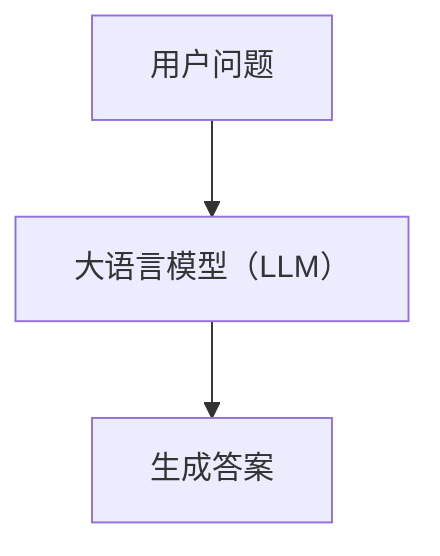
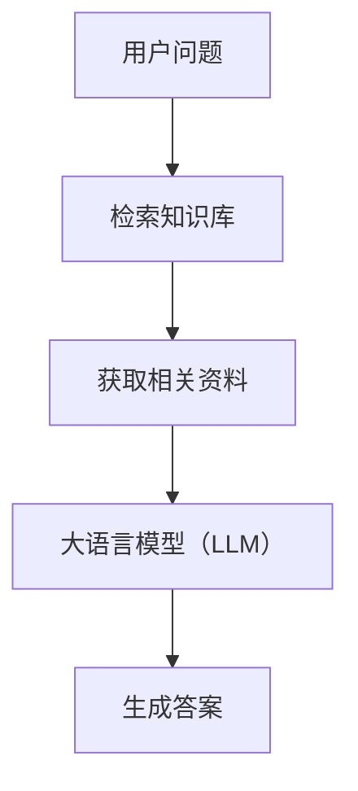
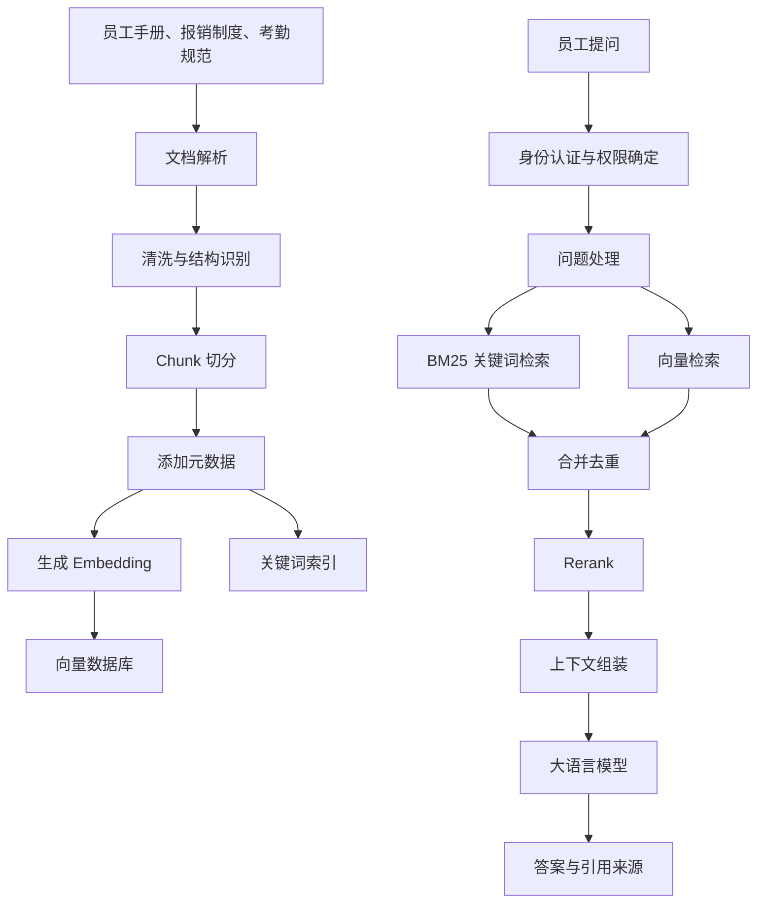
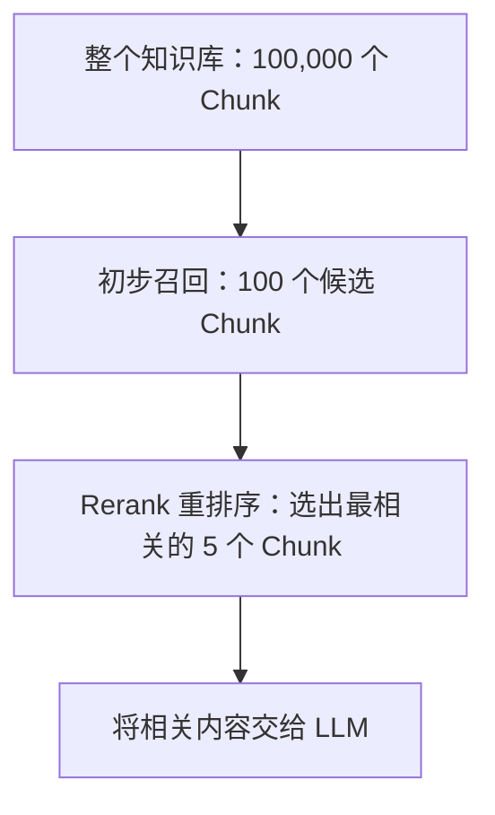
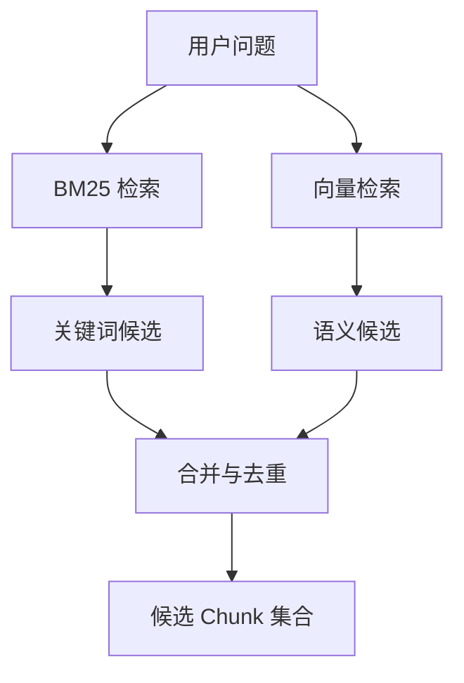
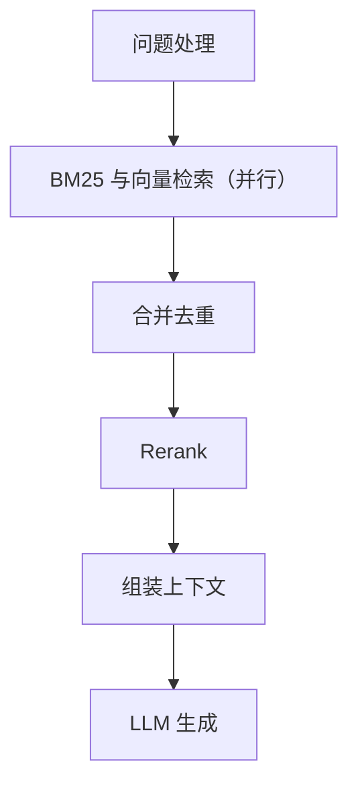

## 摘要

假设我们需要为一家企业搭建员工制度 AI 助手，让员工可以直接询问：

> 正式员工每年有多少天年假？申请年假需要提前多久？

> 出差住宿费可以报销多少？需要提供哪些材料？

> 上班迟到几分钟会被记录？忘记打卡应该怎么办？

这些问题看起来只是简单的问答，但要让 AI 稳定、准确地回答，就需要解决一系列工程问题：

1. 如何将员工手册、报销制度和考勤规则转换为可检索的知识？
2. 什么是 Chunk？为什么不能简单地把整份员工手册直接交给大模型？
3. 如何结合 BM25 关键词检索与向量检索，找到真正相关的内容？
4. 为什么初步召回之后，还可能需要 Rerank 重排序？
5. 如何让大模型基于制度原文回答，并提供引用来源？
6. 如何评估答案质量，并在准确性、延迟和成本之间取得平衡？

本文先总结 RAG 的核心概念，再通过一个完整的员工制度示例，逐步说明知识处理、检索、生成与评估的实现思路。

---

## 一、RAG、Chunk 与相关概念

### 1.1 什么是 RAG？

RAG 是 Retrieval-Augmented Generation 的缩写，中文通常称为“检索增强生成”。

它的核心思路是：

**先从外部知识库中检索相关资料，再将这些资料提供给大语言模型，让模型基于检索结果生成答案。**

传统的大模型问答通常可以简化为：



RAG 则在生成之前增加了知识检索：



这里的知识库可以包含企业内部文档、产品手册、技术文档、合同、FAQ 和业务规范等。

RAG 并不是重新训练一个大模型，也不是让模型永久记住所有企业资料。它是在每次处理问题时，动态地检索相关知识，并将其作为生成答案的依据。

对于企业内部问答，这种方式有三个重要价值：

- **知识可更新：** 制度变更后，可以更新知识库，而不必为了这些变化重新训练大模型。
- **答案可追溯：** 可以将回答关联到原始文档、章节或页码。
- **知识可控制：** 可以结合元数据、用户身份和访问权限，限制检索范围。

但 RAG 并不保证答案一定正确。如果检索阶段漏掉了关键内容，或者检索到了过期制度，模型仍然可能给出错误答案。

### 1.2 什么是 Chunk？

Chunk 是将一份较长的文档切分后得到的文本片段。

例如，一份员工手册可能包含以下章节：

- 员工手册
  - 第一章：入职与离职
  - 第二章：考勤管理
  - 第三章：休假制度
  - 第四章：费用报销
  - 第五章：绩效管理

如果直接把整份员工手册当作一个检索单元，那么当员工询问年假时，系统可能只能找到整份手册，而无法精准定位到年假条款。

因此，可以将文档切分为多个 Chunk：

```text
Chunk 001：年假额度与适用范围
Chunk 002：年假申请流程
Chunk 003：年假结转规则
Chunk 004：迟到与早退规定
Chunk 005：忘记打卡处理流程
Chunk 006：差旅住宿报销标准
Chunk 007：报销材料与审批流程
```

每个 Chunk 都是一个相对独立的检索单元。

当用户询问年假申请流程时，系统可以直接检索与申请规则有关的片段，而不是把整份员工手册重新交给模型处理。

需要注意，Chunk 不一定对应一个完整的自然段，也不一定对应一个固定长度的字符串。它可以是一个段落、几个连续段落、一个表格片段，或者一个经过语义切分的制度条款。

**Chunk 的设计目标，是让每个片段尽量保留完整的业务含义，同时便于检索、排序和引用。**

### 1.3 Chunk Size 和 Overlap 是什么？

Chunk Size 表示一个 Chunk 的目标大小，通常可以按 Token 数量衡量，也可以在某些系统中按字符数衡量。

Overlap 表示相邻 Chunk 之间重复保留的内容，用于降低切分边界造成的信息丢失。

例如，原始制度文本为：

```text
员工每年享有 10 天带薪年假。
申请年假时，应至少提前 3 个工作日提交申请。
连续休假超过 5 个工作日的，需要额外经过部门负责人审批。
```

如果切分得过细，可能得到：

```text
Chunk A：员工每年享有 10 天带薪年假。

Chunk B：申请年假时，应至少提前 3 个工作日提交申请。

Chunk C：连续休假超过 5 个工作日的，需要额外经过部门负责人审批。
```

这在很多情况下是合理的，但如果某条规则必须结合上一段的适用条件才能理解，过细切分就可能破坏上下文。

如果切分得过粗，则可能把年假、考勤、报销等不同主题放进同一个 Chunk，降低检索的精确性。

因此，切分策略需要在上下文完整性和检索精度之间取得平衡。

| 参数 | 作用 | 设置不当的影响 |
|---|---|---|
| Chunk Size | 控制每个片段的大小 | 太小可能缺失上下文，太大可能引入无关内容 |
| Overlap | 保留相邻片段之间的部分重复内容 | 太小可能丢失跨边界信息，太大则增加重复内容和存储成本 |
| 切分边界 | 决定在哪里拆分文档 | 可能把条件、例外或审批要求与主规则拆开 |
| 元数据 | 描述片段的来源、类型和适用范围 | 不利于权限控制、过滤和引用追溯 |

Chunk Size 和 Overlap 没有适用于所有场景的固定最优值。实际项目需要根据文档结构、查询类型、Embedding 模型和评测结果进行调整。

### 1.4 RAG 中几个重要的技术组件

| 组件 | 主要作用 | 通俗理解 |
|---|---|---|
| 文档解析 | 从 PDF、Word、HTML 等文件提取内容 | 先把资料读出来 |
| Chunking | 将文档切分成片段 | 把资料拆成适合检索的小块 |
| Embedding | 将文本转换成向量表示 | 将文本编码成便于计算相似度的数字 |
| 向量检索 | 查找语义相近的片段 | 找意思相近的资料 |
| BM25 | 根据关键词匹配进行排序 | 找包含相关词语的资料 |
| 混合召回 | 合并关键词检索与向量检索结果 | 尽量减少漏掉有用资料的情况 |
| Rerank | 对候选片段进行更精细的相关性排序 | 从候选资料中重新挑出更相关的内容 |
| LLM | 根据检索上下文生成答案 | 阅读资料并组织回答 |
| 元数据过滤 | 根据部门、权限、版本等条件限制检索 | 先确定哪些资料可以被查 |
| 评测 | 衡量检索和回答的实际质量 | 用测试问题验证系统是否真的有效 |

这些组件并不意味着每个 RAG 项目都必须使用全部技术。合理的工程设计应当从最简单、可验证的方案开始，再根据真实问题的失败情况增加复杂度。

---

## 二、员工制度 RAG 知识库的整体设计

### 2.1 明确业务目标

假设一家企业希望将员工手册、报销制度和考勤规范接入 AI 助手。

业务目标不是让模型泛泛地解释人力资源知识，而是让员工能够查询**本企业当前有效的制度**。

例如：

- 年假：额度、申请时间、审批流程、结转规则。
- 报销：费用标准、适用范围、所需凭证、审批流程。
- 考勤：迟到定义、打卡要求、漏打卡处理、异常申诉。

这类业务具有几个典型特点：

1. 制度文本相对稳定，但会定期更新。
2. 部分规则具有明确的数字、时间、金额和条件。
3. 同一个词可能在不同制度中具有不同含义。
4. 员工只能访问其有权限查看的信息。
5. 回答错误可能导致员工依据错误政策采取行动。

因此，知识库不应只关注语义相似度，还需要考虑制度版本、适用对象、有效日期和原始出处。

### 2.2 系统架构

一个基础的企业员工制度 RAG 系统可以分为离线知识处理和在线问答两条链路。



图中的关键词索引和向量数据库属于两种不同的检索基础设施，可以使用不同的存储系统，也可以使用支持混合检索的统一系统实现。

在线请求并不一定要执行所有环节。例如，简单查询可以跳过 Query 改写；如果基础检索的排序质量已经足够好，也可以不使用 Rerank。

### 2.3 为什么要区分离线处理和在线问答？

离线处理负责将原始资料转换为可以检索的知识。

例如：

- 读取员工手册。
- 提取章节、段落和表格。
- 生成 Chunk。
- 添加文档版本与权限元数据。
- 生成 Embedding。
- 建立向量索引和关键词索引。

在线问答负责使用这些知识回答员工问题。

例如：

- 确认当前员工身份和权限。
- 理解员工的问题。
- 从知识库中召回候选 Chunk。
- 对候选内容排序。
- 将相关制度交给 LLM。
- 输出答案及其出处。

这种分工可以避免每次用户提问时都重新解析所有文档和生成全部向量，从而降低在线处理成本。

制度发生变化时，系统通常只需要处理受影响的文档或片段，并更新相应索引。具体如何增量更新，取决于系统是否能够可靠识别文档版本和内容变更。

---

## 三、详细示例：将员工手册切分为 Chunk

### 3.1 原始员工制度

假设企业当前有效的员工手册中存在以下示例条款：

```text
第三章：休假管理

3.1 年假额度
符合公司规定的正式员工，每年享有 10 天带薪年假。

3.2 年假申请
员工申请年假，应至少提前 3 个工作日提交申请，
经直属主管审批后方可休假。

3.3 年假结转
当年度未使用的年假，按照公司另行发布的结转规则处理。

第四章：费用报销

4.1 差旅住宿
员工因公出差产生的住宿费用，应符合对应职级的报销标准。

4.2 报销材料
员工提交住宿费报销时，应提供合规发票、费用明细
及符合公司要求的出差审批材料。
```

这里的具体条款和数字仅用于演示知识库设计，不代表任何真实企业的制度。

原始文档通常按照章节、条款、段落和表格组织。但检索系统需要将它们转换为适合查询的片段。

### 3.2 设计 Chunk

可以按照制度主题和条款边界，将上述内容切分成以下 Chunk：

**Chunk 001：年假额度**

```text
符合公司规定的正式员工，每年享有 10 天带薪年假。
```

**Chunk 002：年假申请流程**

```text
员工申请年假，应至少提前 3 个工作日提交申请，
经直属主管审批后方可休假。
```

**Chunk 003：年假结转规则**

```text
当年度未使用的年假，按照公司另行发布的结转规则处理。
```

**Chunk 004：差旅住宿报销标准**

```text
员工因公出差产生的住宿费用，应符合对应职级的报销标准。
```

**Chunk 005：住宿费报销材料**

```text
员工提交住宿费报销时，应提供合规发票、费用明细
及符合公司要求的出差审批材料。
```

这些 Chunk 并非随机切分，而是尽量让每个片段表达一个相对完整的制度主题。

当用户询问年假额度时，Chunk 001 是主要候选；当用户询问申请时间和审批要求时，Chunk 002 更有价值。

### 3.3 为什么不把整个章节放进一个 Chunk？

假设把第三章全部内容合并为一个 Chunk：

```text
Chunk A：
年假额度、年假申请流程、年假结转规则……
```

这种方式也能工作，但存在一些潜在问题：

- 一个 Chunk 中可能包含多个不同问题的答案。
- 检索结果可能包含较多无关文本。
- 上下文变长，增加生成成本。
- 相关性排序可能更难判断具体条款是否直接回答了问题。

不过，切分也不能过度细化。

例如，将年假申请条款拆成两个 Chunk：

```text
Chunk A：员工申请年假，应至少提前 3 个工作日提交申请。

Chunk B：经直属主管审批后方可休假。
```

如果用户问“年假需要经过审批吗”，第二个片段可以独立回答。但如果问题是“年假申请需要提前多久，以及由谁审批”，系统就需要同时召回两个片段。

因此，对于实际制度文档，可以考虑按条款切分，并在条款包含多个紧密相关的条件时，将它们保留在同一个 Chunk 中。

**判断切分是否合理的标准，不是 Chunk 越短越好，而是它能否完整支持目标问题的回答。**

### 3.4 为 Chunk 添加元数据

仅保存 Chunk 的正文还不够。企业知识库还需要保存文档来源、版本、适用范围和权限等信息。

例如：

```json
{
  "chunk_id": "EMP-LEAVE-002",
  "document_id": "EMP-HANDBOOK-2026",
  "document_title": "员工手册",
  "section": "第三章 休假管理 / 3.2 年假申请",
  "content": "员工申请年假，应至少提前 3 个工作日提交申请，经直属主管审批后方可休假。",
  "document_version": "2026.1",
  "effective_from": "2026-01-01",
  "department": "all",
  "access_scope": "all_employees",
  "chunk_index": 2
}
```

以上 JSON 是示例结构。实际字段应根据企业的数据治理要求设计。

这些字段可以支持：

- 按文档版本筛选当前有效制度。
- 根据适用对象确定哪些条款可以使用。
- 将答案关联回具体章节。
- 在制度更新时定位需要替换的 Chunk。
- 对访问受限的资料执行权限过滤。

尤其需要注意：**权限过滤不能只依赖大模型的提示词。** 应在检索系统或其可信的服务端逻辑中执行访问控制，避免未授权内容进入模型上下文。

---

## 四、从用户提问到检索结果

### 4.1 用户提出问题

假设员工在 AI 助手中输入：

> 正式员工休年假需要提前多久申请？需要谁审批？

系统首先需要理解问题中包含哪些信息：

- 主题：年假申请。
- 目标信息：提前申请时间、审批人。
- 适用对象：正式员工。
- 可能涉及的制度章节：休假管理。

这里不一定需要调用 LLM 改写查询。对于表述清晰的简单问题，可以直接使用原始查询进行检索。

只有在问题过于口语化、存在指代不清或需要拆分多个子问题时，Query 改写或查询拆分才可能带来收益。

### 4.2 什么是召回？

召回（Retrieval）是从知识库中找出可能与用户问题有关的资料。

假设企业知识库有 10 万个 Chunk。系统不可能每次都把全部 10 万个片段交给大模型，因此需要先用检索算法缩小候选范围。

例如：



以上数量只是示例，不是固定配置。

召回阶段通常更关注 Recall，也就是尽可能找回所有真正相关的资料。

假设测试问题有 10 个真正相关的 Chunk：

- 找回 9 个，Recall 为 90%。
- 找回 5 个，Recall 为 50%。
- 找回 2 个，Recall 为 20%。

召回率越高，漏掉有用资料的风险通常越低。

但这不意味着应该无限增加召回数量。候选内容越多，重复和无关信息也可能越多，增加后续排序与生成的成本。

### 4.3 BM25：根据关键词匹配进行检索

BM25 是一种经典的信息检索排序算法，用于评估查询词与文档之间的匹配程度。

例如，员工询问：

> 年假申请要提前几个工作日？

知识库中的原文是：

> 员工申请年假，应至少提前 3 个工作日提交申请。

BM25 可以利用“年假”“申请”“提前”“工作日”等词语的匹配情况，给这个 Chunk 较高的相关性分数。

BM25 通常会综合考虑：

- 查询词是否出现在文档中。
- 某个词在文档中出现的频率。
- 该词在整个文档集合中的区分能力。
- 文档长度等因素。

它的优势是适合精确词项匹配。例如：

- 报销制度编号。
- 考勤异常代码。
- 特定制度名称。
- 明确的金额、型号或业务术语。

但关键词检索也有局限。

例如：

> 我想请几天假，最晚要什么时候报备？

如果原文使用的是“年假申请”，而不是“请假报备”，纯关键词检索可能无法稳定找到最相关的条款。

这就需要考虑向量检索。

### 4.4 向量检索：根据语义相似度进行检索

Embedding 模型可以将文本编码为向量表示。

例如：

```text
用户问题：
我想请几天假，最晚要什么时候报备？

知识库 Chunk：
员工申请年假，应至少提前 3 个工作日提交申请。
```

虽然两者使用的词语不完全相同，但它们表达的意思接近。

向量检索通过比较查询向量和 Chunk 向量之间的距离或相似度，找出语义上接近的候选片段。

通常可以使用余弦相似度或其他向量距离指标，但具体方法取决于 Embedding 模型和向量数据库的配置。

向量检索的优势是能够处理同义表达、自然语言问题和不同措辞之间的语义联系。

但必须区分：

- 语义相似，不代表事实相同。
- 语义相似，不代表制度适用范围相同。
- 语义相似，不代表某条制度当前仍然有效。

例如，旧版员工手册中的年假规则可能与新版非常相似，但两者的有效期限不同。仅凭向量相似度，无法判断应该采用哪一个版本。

因此，企业知识库需要将语义检索与版本、权限和业务规则结合起来。

### 4.5 为什么使用 BM25 + 向量检索混合召回？

两种检索方式擅长处理不同类型的查询。

| 维度 | BM25 | 向量检索 |
|---|---|---|
| 主要依据 | 关键词匹配 | 语义相似度 |
| 精确术语 | 通常表现较好 | 取决于 Embedding 模型 |
| 同义表达 | 可能漏检 | 通常更有优势 |
| 数字、制度编号 | 有助于精确匹配 | 可能把含义相近但数字不同的文本召回 |
| 主要风险 | 无法覆盖不同措辞 | 语义接近但事实不匹配 |

混合召回的基本思路是：



例如，BM25 找到了年假申请条款，而向量检索找到了使用“请假报备”措辞的相关内容。合并两路结果，可以提高找到有效答案的机会。

合并结果时，可以采用 Reciprocal Rank Fusion（RRF，倒数排名融合）等方法，根据候选在不同检索结果中的排名进行融合。

一个简化的 RRF 形式为：

$$
RRF(d)=\sum_{r \in R}\frac{1}{k+\operatorname{rank}_r(d)}
$$

其中：

- $d$ 表示候选 Chunk。
- $R$ 表示不同检索器的结果集合。
- $\operatorname{rank}_r(d)$ 表示 Chunk 在某个检索结果中的排名。
- $k$ 是用于平滑排名影响的常数。

RRF 不要求 BM25 分数和向量相似度必须处于相同数值范围，因此是一种常见的结果融合方式。

但混合检索不是必然优于单一检索。是否需要两路召回，应通过实际测试集比较 Recall@K、Precision@K、延迟和成本后决定。

### 4.6 Rerank：对候选 Chunk 进行精细排序

混合召回解决的是“哪些资料值得进一步考虑”，而 Rerank 解决的是“哪些资料最值得优先使用”。

假设初步召回了以下候选：

| Chunk | 内容 |
|---|---|
| A | 正式员工每年享有 10 天带薪年假。 |
| B | 员工申请年假，应至少提前 3 个工作日提交申请，经直属主管审批后方可休假。 |
| C | 员工请病假时，应及时通知直属主管。 |
| D | 员工提交年假结转申请时，应遵循当年度结转规则。 |

对于问题：

> 正式员工休年假需要提前多久申请？需要谁审批？

Chunk B 是最直接的答案。

其他 Chunk 可能包含“年假”“员工”“申请”等相关词语，但并不能完整回答问题。

Rerank 模型可以将用户问题与每个候选 Chunk 结合起来，对它们的相关性进行更精细的评估。

常见的实现方式是 Cross-Encoder 类模型：模型同时读取查询和候选文本，再输出相关性分数。

需要注意，Rerank 不一定是通用大语言模型。实践中常用专门训练的排序模型，因为它们更适合高效地比较查询与候选文本之间的相关性。

经过排序后，系统可以选取前几个 Chunk，交给后续生成模型。

Rerank 的优势是改善候选排序，但也会引入额外的计算成本和延迟。因此，是否启用、处理多少候选，以及选用哪种模型，都应该通过实际评测确定。

---

## 五、从检索结果生成答案

### 5.1 组装上下文

经过召回与排序后，系统获得与问题最相关的制度片段。

例如：

```text
[来源：员工手册 / 第三章 休假管理 / 3.2 年假申请]

员工申请年假，应至少提前 3 个工作日提交申请，
经直属主管审批后方可休假。
```

接下来，系统将用户问题和检索到的资料一起提供给 LLM。

可以采用类似下面的提示词：

```text
你是企业员工制度问答助手。

请根据提供的制度资料回答员工问题。

要求：
1. 以提供的制度资料为主要依据。
2. 不要编造资料中没有的制度、数字或审批条件。
3. 如果资料不足以回答问题，请明确说明。
4. 如果存在适用范围或版本差异，请指出差异。
5. 在答案中注明制度来源。

用户问题：
正式员工休年假需要提前多久申请？需要谁审批？

制度资料：
员工申请年假，应至少提前 3 个工作日提交申请，
经直属主管审批后方可休假。
```

### 5.2 生成最终答案

模型可以生成：

> 正式员工申请年假，应至少提前 3 个工作日提交申请，并经直属主管审批后方可休假。
>
> 来源：员工手册，第三章“休假管理”，第 3.2 条“年假申请”。

这比直接让模型根据通用知识回答更容易验证，因为答案中的具体规则可以追溯到原始制度。

但提示词本身并不能保证模型完全忠实于资料。生产环境还应检查引用是否真实存在、引用内容是否支持对应结论，以及模型是否遗漏重要的适用条件。

### 5.3 如果检索不到答案怎么办？

假设员工询问：

> 年假最多可以连续休多少天？

但当前知识库只包含年假额度和申请流程，没有连续休假天数的规定。

此时不应让模型根据常识自行补出一个数字。

更合理的回答是：

> 当前检索到的员工制度资料没有明确说明年假最多可以连续休多少天。建议查阅完整休假制度或向人力资源部门确认。

在企业制度问答中，能够识别知识缺口和明确表达不确定性，同样是系统质量的重要组成部分。

---

## 六、如何处理报销和考勤问题？

同一套 RAG 架构可以服务于不同的员工制度主题，但切分策略和检索条件需要根据具体业务调整。

### 6.1 报销制度示例

用户问题：

> 出差住酒店报销需要哪些材料？

知识库中有两个相关 Chunk：

```text
Chunk 004：
员工因公出差产生的住宿费用，应符合对应职级的报销标准。

Chunk 005：
员工提交住宿费报销时，应提供合规发票、费用明细
及符合公司要求的出差审批材料。
```

这里，Chunk 005 可以直接回答材料要求，Chunk 004 则提供报销适用条件。

如果员工进一步询问：

> 我是 P5 级员工，住宿费每天最多能报销多少？

系统需要检索对应职级的具体标准。如果知识库没有该标准，就不能只根据“对应职级的报销标准”推导出具体金额。

这说明企业 RAG 不只是要找到主题相关的文本，还要判断检索结果是否包含回答所需的全部信息。

### 6.2 考勤制度示例

用户问题：

> 忘记打卡怎么办？

知识库可能包含：

```text
Chunk 006：
员工上下班应按照公司要求完成考勤打卡。

Chunk 007：
员工因特殊情况未能正常打卡时，应按照考勤异常处理流程
提交说明及相关证明，并由对应负责人审批。
```

如果系统只召回 Chunk 006，虽然内容与考勤有关，但没有完整回答忘记打卡后的处理方法。

因此，在设计 Chunk 时，应尽量将操作流程、适用条件和审批要求保留完整；在评估检索质量时，也要测试系统是否能够找齐回答问题所需的多个片段。

---

## 七、企业 RAG 的关键工程问题

### 7.1 制度版本与增量更新

员工制度可能每年更新，部分制度也可能临时调整。

如果新版制度已经生效，但向量数据库中仍然存在旧版 Chunk，系统就可能召回过期规定。

因此，建议为每份文档保存：

- 文档 ID 和版本号。
- 生效日期和失效日期。
- 文档状态。
- 适用对象。
- 来源文件及章节定位。

制度更新时，应识别变更内容，更新对应的 Chunk 和检索索引，并确保失效制度不再作为当前有效答案的依据。

对于重要制度，建议保留变更记录和索引更新时间，以便排查为什么系统在某个时间点返回了特定规则。

### 7.2 权限与知识隔离

企业知识库不一定对所有员工开放。

例如：

- 普通员工可以查询通用年假和考勤制度。
- 部门负责人可能可以访问部分部门级流程。
- 人力资源人员可能可以访问受限的人事政策。

系统应在检索阶段，根据已经验证的用户身份和授权范围限制候选文档。

不能先将所有敏感资料检索出来，再仅仅依靠提示词要求模型不要泄露。

权限过滤还应覆盖引用来源、缓存、日志和后续工具调用，避免未授权信息通过其他路径泄露。

### 7.3 结构化数据不一定需要向量检索

不是所有员工问题都适合通过 RAG 解决。

例如：

- “差旅住宿费的报销标准是什么？”适合检索制度文档。
- “我的报销单现在审批到哪一步了？”可能需要调用报销系统 API。
- “我本年度还剩几天年假？”可能需要查询 HR 系统中的个人余额。

可以根据问题类型路由到不同的数据源：

| 问题类型 | 建议处理方式 |
|---|---|
| 查询制度条款 | RAG 文档检索 |
| 查询个人年假余额 | 调用 HR 系统 API |
| 查询报销审批状态 | 调用报销系统 API |
| 计算报销金额 | 使用明确的业务规则和计算逻辑 |
| 需要综合多个制度的复杂问题 | RAG 检索后由 LLM 综合分析 |

需要注意，个人余额、审批状态等动态业务数据不应仅依靠静态员工手册回答。它们需要来自有权限控制的实时业务系统。

---

## 八、如何评估 RAG 是否真正有效？

不能因为系统能够返回一段看似合理的答案，就认为 RAG 已经搭建成功。

建议将评估拆分为检索质量、答案质量、性能与成本几个维度。

### 8.1 检索指标

**Recall@K（前 K 个结果的召回率）**

衡量前 K 个检索结果找回了多少真正相关的资料。

$$
Recall@K =
\frac{\text{前 K 个结果中的相关资料数}}
{\text{全部相关资料数}}
$$

假设某个测试问题有 5 个相关 Chunk，系统前 10 个结果找到了其中 4 个：

$$
Recall@10 = \frac{4}{5}=80\%
$$

Recall@K 越高，通常表示系统漏掉的相关资料越少。

**Precision@K（前 K 个结果的精确率）**

衡量前 K 个结果中，有多少是真正相关的资料。

$$
Precision@K =
\frac{\text{前 K 个结果中的相关资料数}}{K}
$$

假设前 10 个结果中有 6 个相关：

$$
Precision@10 = \frac{6}{10}=60\%
$$

Recall 和 Precision 需要结合观察：只返回极少数结果可能很精确，却容易漏掉答案；返回大量结果可能找得更全，却带入许多无关资料。

**MRR（Mean Reciprocal Rank）**

衡量第一个相关结果出现得有多靠前。相关结果越早出现，MRR 通常越高。

**nDCG（Normalized Discounted Cumulative Gain）**

衡量排序结果的整体质量，并考虑不同排名位置的价值。越相关的结果排得越靠前，通常越有利。

### 8.2 答案质量指标

检索正确不代表生成一定正确。

建议测试：

- **答案正确率：** 是否正确回答问题。
- **忠实度（Faithfulness）：** 答案中的事实是否得到检索资料支持。
- **引用准确率：** 引用是否指向真实存在、且能够支持结论的内容。
- **拒答合理性：** 知识库缺少答案时，是否能够明确说明信息不足。
- **条件完整性：** 是否遗漏审批人、适用对象、生效时间等关键条件。

可以构建一组标准测试问题：

| 测试问题 | 主要验证目标 |
|---|---|
| 正式员工每年有多少天年假？ | 精确数字检索 |
| 年假需要提前多久申请？ | 条款定位 |
| 请假需要谁审批？ | 条件与流程完整性 |
| 住宿费报销需要哪些材料？ | 多项要求召回 |
| 忘记打卡应该怎么办？ | 操作流程检索 |
| 旧版和新版制度规定不同，应该按哪个执行？ | 版本管理 |
| 当前制度没有说明连续休假上限，能否回答具体天数？ | 拒答与不确定性处理 |

这些测试问题可以持续用于比较不同 Chunk 策略、检索参数和模型版本。

### 8.3 延迟和成本

RAG 会增加检索、排序和上下文处理的开销。

例如，在线请求可能经过：



其中，BM25 和向量检索可以并行执行；Query 改写和 Rerank 则不一定适合每个请求。

实际系统应监控：

- 首次输出延迟。
- 完整回答延迟。
- P50、P95 等延迟分位数。
- 输入与输出 Token 数量。
- 单次请求成本。
- 检索失败率和重试次数。

不能只追求 Recall@K，而忽略线上延迟。也不能只追求低成本，而让系统经常漏掉真正的制度条款。

### 8.4 通过对照实验选择检索方案

建议至少比较以下几种配置：

| 方案 | 检索方式 | 主要目的 |
|---|---|---|
| A | 仅 BM25 | 建立关键词检索基线 |
| B | 仅向量检索 | 建立语义检索基线 |
| C | 混合召回 | 验证两种检索方式是否互补 |
| D | 混合召回 + Rerank | 验证重排序能否提升最终质量 |

在同一组测试问题、同一套制度快照和一致的评估条件下，比较各方案的 Recall@K、Precision@K、答案正确率、引用准确率、P95 延迟与请求成本。

如果混合召回的提升很小，而延迟和成本明显增加，就应考虑保留更简单的方案。

如果 Rerank 明显改善了关键制度问题的排序与回答质量，再决定是否将其纳入生产链路。

---

## 九、总结：从最小可用 RAG 开始

为企业搭建员工制度知识库，不需要一开始就引入所有复杂组件。

一个合理的实施顺序是：

1. **整理知识源：** 收集当前有效的员工手册、报销制度和考勤规范。
2. **设计 Chunk：** 优先按照章节、条款和业务语义切分，避免破坏关键条件。
3. **保存元数据：** 记录来源、版本、生效时间、适用范围和访问权限。
4. **建立检索索引：** 根据查询特点选择关键词检索、向量检索或混合召回。
5. **接入 LLM：** 将相关制度片段交给模型生成答案，并要求提供来源。
6. **建立测试集：** 用真实员工问题验证召回质量、答案正确性和引用准确率。
7. **持续优化：** 根据漏检、误检、过期知识、延迟和成本数据调整系统。

整个过程可以概括为：

**文档解析、Chunk 切分、元数据管理、检索召回、按需 Rerank、LLM 生成、引用验证与评测迭代。**

其中最重要的不是把每个技术名词都堆进系统，而是理解每个组件解决什么问题，以及它是否真正改善了业务结果。

对于员工制度问答，Chunk 决定知识如何组织，检索决定能否找到正确资料，Rerank 决定候选资料的优先级，LLM 负责根据资料组织答案，而版本管理、权限控制和评测决定系统能否可靠地运行在企业环境中。